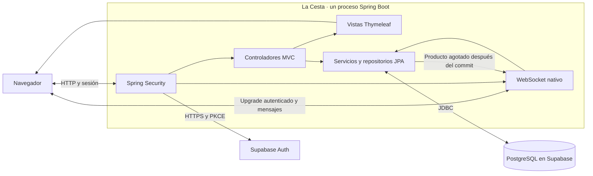
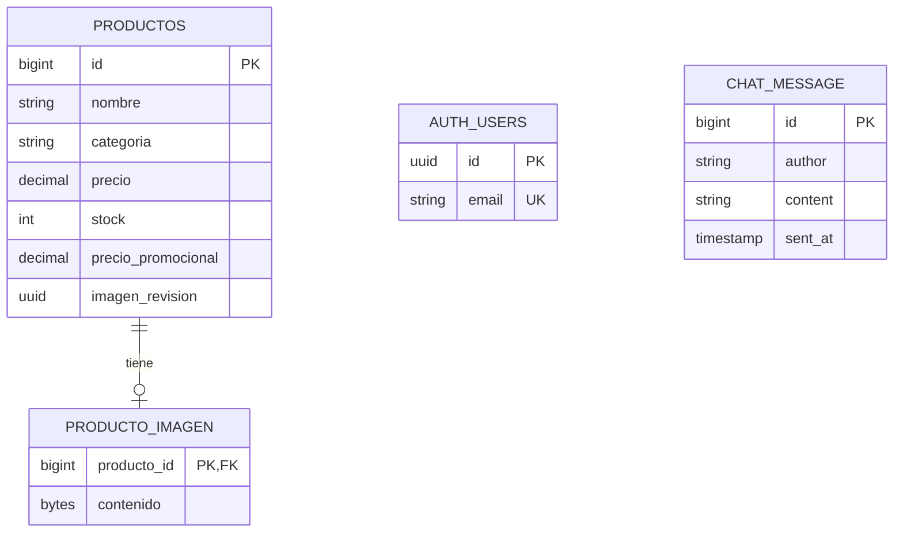

# La Cesta

La Cesta es un minimarket ficticio de Quito. Su personal necesita mantener en un solo lugar los precios, las promociones y las existencias que consultan sus clientes. El catálogo resuelve esa consulta y la sala general permite comentar productos y preguntar al personal.

Aplicaciones Web Avanzadas · Primer bimestre · Versión 1.0-b1

El [análisis de requerimientos](docs/REQUERIMIENTOS.md) incluye los objetivos, los criterios de aceptación, el modelo de datos y el guion para la defensa. El [plan de cierre original](docs/Plan%20de%20cierre%20del%20primer%20bimestre.docx) recoge la planificación previa al cambio de autenticación.

## Stack tecnológico

| Capa | Tecnología |
| --- | --- |
| Aplicación monolítica | Java 17, Spring Boot 3.5, Spring MVC y Maven |
| Interfaz | Thymeleaf, HTML, CSS y JavaScript |
| Seguridad | Supabase Auth para credenciales y Spring Security para sesiones HTTP y autorización |
| Persistencia | Spring Data JPA, Hibernate y Flyway sobre PostgreSQL en Supabase |
| Tiempo real | WebSocket seguro (WSS) de Spring para mensajes, presencia y avisos de agotado |

## Configurar Supabase

1. En **Connect → Session pooler**, copia el host y el usuario de la conexión PostgreSQL en el puerto 5432. En **Database Settings → SSL Configuration**, descarga el certificado CA. Usa la contraseña de la base de datos del proyecto. [Conectar a PostgreSQL](https://supabase.com/docs/guides/database/connecting-to-postgres#ssl)
2. En **Project Settings → API Keys**, copia la clave **Publishable** y localiza el **Project URL** en **Connect**. La aplicación usa esa clave para el flujo público de Auth y mantiene las credenciales de PostgreSQL en el servidor. [Claves API de Supabase](https://supabase.com/docs/guides/api/api-keys)
3. En **Authentication → URL Configuration**, añade las dos URL de retorno exactas. Para probar desde IntelliJ son `https://localhost:8080/confirmar` y `https://localhost:8080/restablecer`. Para desplegar, añade las rutas equivalentes bajo el dominio HTTPS de `APP_PUBLIC_URL`. Conserva las plantillas de correo con `{{ .ConfirmationURL }}` para confirmación y recuperación. El usuario debe abrir el enlace en el mismo navegador en que lo solicitó. [Flujo PKCE](https://supabase.com/docs/guides/auth/sessions/pkce-flow)
4. En **Authentication → Sign In / Providers**, habilita correo y contraseña y mantén activa la confirmación de correo. Configura SMTP propio para enviar correos a clientes ajenos al equipo. [Contraseñas en Supabase Auth](https://supabase.com/docs/guides/auth/passwords) · [SMTP personalizado](https://supabase.com/docs/guides/auth/auth-smtp)

## Ejecutar en IntelliJ IDEA

1. Abre la carpeta como proyecto Maven y selecciona un JDK 17 a 25. Detén la ejecución anterior antes de cambiar de configuración.
2. En **Run → Edit Configurations**, duplica **La Cesta Supabase** como configuración local. Carga las variables reales en **Environment variables**. La [.env.example](.env.example) es una plantilla para rellenar esas entradas.
3. Prepara el certificado local siguiendo los comandos de esta sección. Ejecuta la configuración y abre [La Cesta](https://localhost:8080/ingresar). Flyway crea o actualiza el esquema `la_cesta`. La base del proyecto Supabase y los archivos históricos de la demo son independientes.
4. Registra y confirma la cuenta que administrará la tienda. En **Authentication → Users**, copia su **User UID** y guárdalo como `APP_ADMIN_USER_ID`. Reinicia La Cesta y vuelve a iniciar sesión. Al entrar se abre el **Panel de administración** en `/admin`, donde puedes consultar existencias y usar **Añadir producto**. **Vista de tienda** abre el catálogo para revisar cómo se presenta a los clientes. Para probar el flujo de cliente en paralelo, usa otra cuenta en una ventana privada.

En la terminal de IntelliJ, ejecuta estos comandos desde la carpeta del proyecto. El primer comando prepara un certificado de desarrollo para `localhost` y `127.0.0.1`. El segundo agrega su certificado público a la confianza de Windows para tu usuario.

```powershell
powershell.exe -NoProfile -ExecutionPolicy Bypass -File .\scripts\prepare-local-tls.ps1
Import-Certificate -FilePath .\data\tls\localhost.cer -CertStoreLocation Cert:\CurrentUser\Root
```

Si tu JDK no está en `JAVA_HOME` o en `PATH`, añade `-JdkPath` con la ruta del JDK de IntelliJ al primer comando. El almacén y su contraseña se guardan en `data/tls`, excluido de Git. El chat abre una conexión `wss://localhost:8080/ws/chat` desde la página HTTPS.

Para introducir la contraseña de PostgreSQL al arrancar, configura las demás variables en la terminal de IntelliJ y usa PowerShell 7. Esto evita guardarla en la configuración del IDE.

```powershell
$env:DB_PASSWORD = Read-Host 'Contraseña de PostgreSQL' -MaskInput
try {
    mvn spring-boot:run
} finally {
    Remove-Item Env:DB_PASSWORD
}
```

Para desplegar con TLS directo, usa un certificado válido para tu dominio y configura `APP_TLS_KEY_STORE`, `APP_TLS_KEY_STORE_PASSWORD` y `APP_PUBLIC_URL`. Si un proxy confiable termina HTTPS, configura `APP_TLS_ENABLED=false` y `APP_FORWARD_HEADERS_STRATEGY=framework`, mantén el backend privado y haz que el proxy reemplace los encabezados reenviados y admita la actualización WebSocket. El servidor exige que la solicitud del chat llegue identificada como segura.

## Fotos del catálogo

Entra como administrador y abre **Añadir producto** o **Editar producto**. En **Foto del producto**, selecciona un JPG o PNG de hasta 5 MB y 24 megapíxeles. Puedes revisar la vista previa antes de guardar. Para reemplazar una foto, selecciona otro archivo. Para retirarla, marca **Quitar la foto actual al guardar**.

Los productos sin imagen muestran **Sin foto** hasta que el administrador suba un archivo.

## Consultar los datos en Supabase

Abre **Table Editor**, selecciona el esquema `la_cesta` y entra en `productos`. Flyway crea el esquema en el primer arranque conectado. Consulta los usuarios en **Authentication → Users**. [Base de datos en el panel de Supabase](https://supabase.com/docs/guides/database/overview)

También puedes consultar el catálogo desde **SQL Editor** con esta consulta de solo lectura.

```sql
select id, nombre, categoria, precio, stock
from la_cesta.productos
order by id desc
limit 20;
```

## Variables de entorno

[.env.example](.env.example) es la plantilla pública. Introduce los valores reales en **Environment variables** de una configuración local de IntelliJ, o configúralos en el entorno del proceso que ejecuta Spring Boot.

| Variable | Uso |
| --- | --- |
| `DB_HOST` | Host del Session pooler, sin protocolo ni puerto. La aplicación fija el puerto 5432 y `sslmode=verify-full`. |
| `DB_USER` | Usuario de PostgreSQL, con permisos sobre el esquema de la aplicación. |
| `DB_PASSWORD` | Contraseña de PostgreSQL. |
| `DB_SSL_ROOT_CERT` | Ruta al certificado CA descargado de Supabase. |
| `SUPABASE_URL` | Origen HTTPS del proyecto, por ejemplo `https://PROJECT_REF.supabase.co`. |
| `SUPABASE_PUBLISHABLE_KEY` | Clave `sb_publishable_…` para llamar a Supabase Auth. |
| `APP_ADMIN_USER_ID` | UUID del usuario de Supabase Auth autorizado para administrar el catálogo. Si queda vacío, las cuentas tienen acceso de cliente. |
| `APP_PUBLIC_URL` | Origen de La Cesta para enlaces de correo. El valor local es `https://localhost:8080`. |
| `APP_TLS_ENABLED` | `true` por defecto. Usa `false` si un proxy de confianza termina TLS. |
| `APP_TLS_KEY_STORE` | Ubicación del almacén PKCS#12 cuando Spring gestiona HTTPS. La configuración local usa `data/tls/localhost.p12`. |
| `APP_TLS_KEY_STORE_PASSWORD` | Contraseña del almacén PKCS#12. El script de desarrollo la guarda en `data/tls/local.properties`. |
| `APP_FORWARD_HEADERS_STRATEGY` | `none` por defecto. Usa `framework` si un proxy confiable gestiona HTTPS y reenvía los encabezados. |

## Credenciales y datos de prueba

Publica solo `.env.example` con valores de muestra. Guarda las contraseñas, los tokens y las claves privadas fuera del repositorio. Usa cuentas, mensajes y datos de una PYME ficticia para las pruebas. Para publicar datos o fotos de una PYME real, obtén autorización y retira cualquier dato personal.

Desde la carpeta del proyecto, revisa los archivos preparados para el commit con `git diff --cached --name-only -- .`. Excluye archivos `.env` reales, configuraciones locales de IntelliJ, bases de datos, volcados, capturas y logs con datos o credenciales. `.gitignore` protege archivos sin seguimiento. Si uno ya está bajo seguimiento, retíralo del índice antes de publicar.

Si se expone una credencial, revócala o cambia la contraseña desde el servicio correspondiente. Configura el reemplazo en el entorno local o de despliegue y verifica que el valor anterior haya quedado inválido. Si se publicó en Git, coordina con el equipo su retirada del historial y la revisión de las copias compartidas.

Supabase Auth guarda las contraseñas como hashes BCrypt. Spring intercambia las credenciales por HTTPS y valida el JWT de acceso con el endpoint de usuario de Supabase Auth. La verificación se aplica al inicio de sesión y a los enlaces PKCE. Spring mantiene su propia sesión con cookie HttpOnly y SameSite. El JWT solo se usa en el servidor y se descarta tras el uso. El permiso de administrador depende del UUID verificado y configurado por el operador. JPA usa parámetros en sus consultas y JDBC verifica el certificado y el host. La migración de PostgreSQL mantiene las tablas de la aplicación fuera del acceso de los roles de la Data API y habilita RLS como defensa adicional. Supabase cifra los datos del proyecto en reposo. [Seguridad de Supabase](https://supabase.com/security) · [SSL de pgJDBC](https://jdbc.postgresql.org/documentation/ssl/)

## Consulta periódica

La automatización **Consulta periódica de La Cesta en Supabase** ejecuta `SELECT 1` cada seis horas desde Codex. El monitor es de solo lectura y funciona independientemente de IntelliJ mientras el programador local de Codex esté disponible. Los proyectos gratuitos siguen sujetos a la política de pausa de Supabase. [Política de pausa de proyectos](https://supabase.com/docs/guides/platform/free-project-pausing)

## Cómo fluye una operación



1. Spring Security autentica al usuario en Supabase Auth y crea la sesión de La Cesta. Thymeleaf renderiza el catálogo en el servidor.
2. Un administrador guarda un producto. Spring valida el formulario y verifica que la foto se pueda leer como JPG o PNG. Si hay una foto nueva, la convierte a JPEG optimizado y la guarda en la misma transacción del producto. JPA usa el número de versión para evitar que dos ediciones sobrescriban sus cambios.
3. En la sala general, el navegador solicita cambiar de HTTP a WebSocket. Spring autentica la sesión y comprueba el origen. El servidor envía el historial y la cantidad de usuarios distintos conectados.
4. Un usuario envía texto. El servidor normaliza y valida el contenido, lo guarda y lo distribuye a la sala. El navegador agrega el texto al historial sin recargar.
5. Si un producto pasa de stock positivo a cero, el mismo servidor publica el aviso en la sala después de que se confirme la transacción.

### Modelo de datos



El chat guarda el nombre visible del autor al enviar el mensaje. Supabase gestiona las identidades en `auth.users`. La tabla `la_cesta.app_user` queda como registro de la versión anterior y la aplicación ya no la consulta. Flyway aplica el esquema desde [db/migration](src/main/resources/db/migration) y las restricciones propias de PostgreSQL desde [db/postgresql](src/main/resources/db/postgresql).

## Pruebas

```powershell
mvn test
mvn package
```

Las pruebas automatizadas usan H2 en memoria y respuestas simuladas de Supabase Auth. Cubren autenticación, PKCE, permisos, validación, CRUD, fotos, paginación, edición concurrente y WebSocket. El JAR se genera en `target/la-cesta-1.0-b1.jar` y utiliza PostgreSQL al ejecutarse.

En una verificación previa en Brave se comprobó el catálogo con fotos a 390, 768 y 1440 px, además de la vista previa, la carga, el reemplazo y la retirada de imágenes. Para verificar un proyecto remoto, ejecuta el monolito con sus variables, confirma un correo, inicia sesión, guarda un producto y comprueba la fila en Table Editor.

### Medición local

Se ejecutó una consulta JDBC de la primera página de Bebidas sobre 10 000 productos ficticios en H2 2.3.232 en memoria, con Java 23. Se calentó la consulta 20 veces y se midieron otras 100 ejecuciones, incluida la lectura de las ocho filas. La mediana fue **0,034 ms** y el percentil 95 fue **0,071 ms**.

```sql
SELECT id, nombre
FROM productos
WHERE categoria = 'BEBIDAS'
ORDER BY id DESC
LIMIT 8;
```

`EXPLAIN ANALYZE` confirmó el uso del índice `productos_categoria_id_idx` en el filtro. La medición es local y cubre la consulta SQL de la página.

## Integrantes

Completa la tabla con los nombres o alias autorizados por el equipo. Los roles son una propuesta que debe ajustarse al trabajo de cada integrante.

| Integrante | Rol propuesto | Responsabilidad |
| --- | --- | --- |
| Por completar | Análisis y coordinación | Requerimientos, alcance y preparación de la defensa |
| Por completar | Cuentas y seguridad | Registro, sesiones y recuperación de contraseña |
| Por completar | Catálogo e interfaz | Productos, inventario, promociones y fotos |
| Por completar | Tiempo real y calidad | WebSocket, pruebas y verificación del despliegue |

Si el grupo tiene cinco integrantes, puede repartir el catálogo y la interfaz entre dos personas.

## Uso de IA

Se utilizó Codex y sus subagentes para plantear los requisitos, redactar la documentación e implementar y verificar la aplicación. Se aplicó [Ponytail](https://github.com/dietrichgebert/ponytail) para reducir la complejidad del código, y se consultaron [Taste Skill](https://www.tasteskill.dev/) e [Impeccable](https://github.com/pbakaus/impeccable) para la jerarquía visual, los estados de interfaz y la revisión responsiva. El emblema de la tienda, la portada y las fotos ilustrativas de los productos ficticios se generaron con ImageGen. Las tres fotografías del carrusel también se generaron con ImageGen. La nueva portada toma del video de OraSì la composición a todo el ancho, los bordes orgánicos y el ritmo de las secciones. Las cuatro imágenes editoriales y el banner de surtido general se generaron con ImageGen como escenas propias de La Cesta. Los cambios de diapositiva, la entrada al desplazarse y el destello de los botones adaptan patrones de [Frontend Animations](https://github.com/pulkit-30/Frontend-Animations). La portada incluye pausa, navegación por teclado y respeto por la preferencia de movimiento reducido. Los títulos usan [Barlow Condensed](https://github.com/google/fonts/tree/main/ofl/barlowcondensed), distribuida con su licencia SIL OFL. El equipo debe revisar, probar y poder explicar y modificar el código que presenta.
