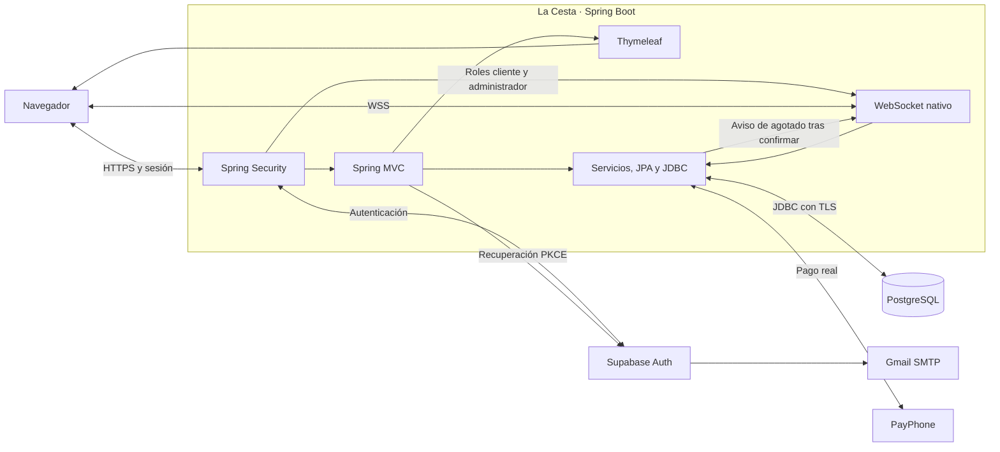
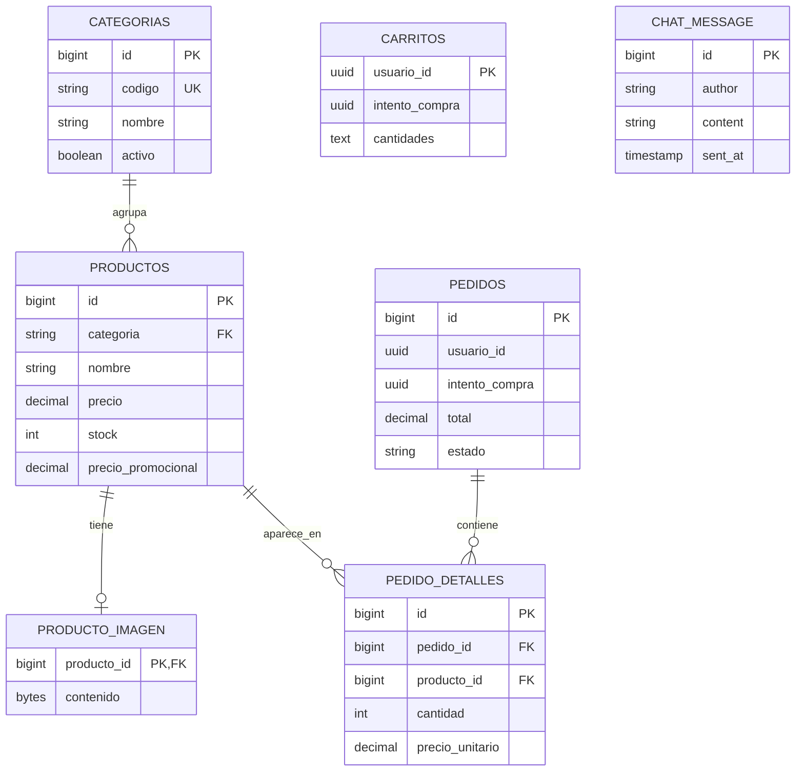

<p align="center">
  
</p>

<h1 align="center">La Cesta</h1>

<p align="center"><strong>Catálogo, inventario y compras para un minimarket de Quito</strong></p>
<p align="center">Aplicaciones Web Avanzadas · Primer bimestre · Versión 1.0-b1</p>

<p align="center">
  
</p>

[Qué resuelve](#qué-resuelve) · [Puesta en marcha](#puesta-en-marcha) · [Variables](#variables-de-entorno) · [Arquitectura](#arquitectura) · [Pruebas](#pruebas) · [Equipo e IA](#equipo-e-ia)

## Qué resuelve

La Cesta es un minimarket ficticio de Quito. Su personal necesita mantener precios, existencias y promociones al día en un solo lugar. Los clientes necesitan saber qué está disponible, consultar sus compras y conversar con la tienda.

| Perfil | Funciones principales |
| --- | --- |
| **Cliente** | Explora el catálogo y las ofertas, conserva su carrito entre sesiones, confirma pedidos y consulta **Mis compras** con cinco pedidos por página. Puede participar en la sala general. |
| **Administrador** | Gestiona categorías, productos, fotos, inventario, promociones y pedidos confirmados. Puede responder en la sala general. |
| **Repartidor** | Consulta los pedidos por entregar y actualiza su estado. |

[Requerimientos y criterios de aceptación](docs/REQUERIMIENTOS.md) · [Plan original del primer bimestre](docs/Plan%20de%20cierre%20del%20primer%20bimestre.docx)

## Puesta en marcha

Necesitas **JDK 17 o 21**, **Maven 3.6.3 o posterior**, **IntelliJ IDEA** y un proyecto de **Supabase**. [Requisitos de Spring Boot](https://docs.spring.io/spring-boot/3.5/system-requirements.html)

### 1. Clona y abre el proyecto

```powershell
git clone https://github.com/SaulTualombo01/LaCesta-ProyectoWebAvanzadas.git
cd LaCesta-ProyectoWebAvanzadas
```

En IntelliJ, entra en **File → Open**, selecciona la carpeta clonada e importa el proyecto desde el [pom.xml](pom.xml). Verifica el JDK en **File → Project Structure → Project**.

### 2. Configura Supabase

1. Abre **Connect → Session pooler** y copia el host y el usuario de PostgreSQL. La aplicación usa el puerto `5432`. Descarga el certificado CA en **Database → Settings → SSL Configuration**. [Conexión a PostgreSQL y TLS](https://supabase.com/docs/guides/database/connecting-to-postgres)
2. En **Settings → API Keys**, localiza la clave **Publishable**. Copia también la URL del proyecto desde **Connect**. [Claves API](https://supabase.com/docs/guides/api/api-keys)
3. En **Authentication → Sign In / Providers**, habilita el acceso por correo y contraseña con confirmación de correo. En **Authentication → URL Configuration**, agrega estas URL de retorno exactas. Para un despliegue, usa el dominio HTTPS de `APP_PUBLIC_URL`. [URL de retorno](https://supabase.com/docs/guides/auth/redirect-urls)

   ```text
   https://localhost:8080/confirmar
   https://localhost:8080/restablecer
   ```

### 3. Prepara HTTPS local y ejecuta

Desde la terminal de IntelliJ, situada en la carpeta del proyecto, ejecuta estos comandos. El primero genera el certificado local. El segundo lo agrega a los certificados de confianza del usuario de Windows.

```powershell
powershell.exe -NoProfile -ExecutionPolicy Bypass -File .\scripts\prepare-local-tls.ps1
Import-Certificate -FilePath .\data\tls\localhost.cer -CertStoreLocation Cert:\CurrentUser\Root
```

Si el script no encuentra Java, agrega `-JdkPath` con la ruta del JDK que elegiste en IntelliJ. El almacén TLS y su configuración se generan en `data/tls`.

1. Abre **Run → Edit Configurations → + → Application**.
2. Usa `ec.minimarket.cesta.LaCestaApplication` como **Main class** y la carpeta del repositorio como **Working directory**. Si IntelliJ pide un módulo, selecciona `la-cesta`.
3. En **Environment variables**, introduce las variables de [`.env.example`](.env.example) usando la tabla de [Variables de entorno](#variables-de-entorno).
4. Pulsa **Run** y abre [La Cesta](https://localhost:8080/ingresar). Flyway prepara el esquema `la_cesta` y crea las categorías iniciales. El catálogo de un proyecto nuevo empieza vacío y se llena desde el panel de administración.

<details>
<summary>Arrancar desde PowerShell 7</summary>

Configura las demás variables en la terminal. Puedes introducir la contraseña de PostgreSQL al ejecutar Maven y retirarla del entorno al terminar.

```powershell
$env:DB_PASSWORD = Read-Host 'Contraseña de PostgreSQL' -MaskInput
try {
    mvn spring-boot:run
} finally {
    Remove-Item Env:DB_PASSWORD
}
```

</details>

### 4. Habilita la cuenta administradora

Registra y confirma una cuenta. En **Authentication → Users**, copia su **User UID** y asígnalo a `APP_ADMIN_USER_ID`. Reinicia La Cesta e inicia sesión. El **Panel de administración** se abre en `/admin`.

Para probar cliente y administrador a la vez, usa dos perfiles del navegador o una ventana normal y otra privada. Las pestañas del mismo perfil comparten la sesión.

### Correo con Gmail y recuperación de contraseña

1. En la cuenta remitente de Google, activa la verificación en dos pasos y genera una contraseña de aplicación para **La Cesta SMTP**. [Contraseñas de aplicación de Google](https://support.google.com/accounts/answer/185833?hl=es)
2. En [**Authentication → SMTP Settings**](https://supabase.com/dashboard/project/_/auth/smtp), activa **Enable custom SMTP**, completa estos campos y guarda. [SMTP de Supabase](https://supabase.com/docs/guides/auth/auth-smtp) · [Servidor SMTP de Gmail](https://support.google.com/mail/answer/7104828)

   | Campo | Valor |
   | --- | --- |
   | Sender email address y Username | El correo completo de Google |
   | Sender name | `La Cesta` |
   | Host | `smtp.gmail.com` |
   | Port | `465` con SSL o `587` con STARTTLS |
   | Password | La contraseña de aplicación que generó Google |

3. En [**Authentication → Emails → Templates → Reset password**](https://supabase.com/dashboard/project/_/auth/templates/reset-password), revisa el asunto **Restablece tu contraseña en La Cesta** y el botón **Restablecer contraseña**. Conserva `{{ .ConfirmationURL }}` al recrear o modificar la plantilla verde y crema. [Variables de plantillas](https://supabase.com/docs/guides/auth/auth-email-templates)
4. Solicita el enlace desde **¿La olvidaste?**. Ábrelo en el mismo navegador y perfil, y completa el cambio dentro de los **20 minutos** posteriores a la solicitud.

Gmail entrega el mensaje. Spring intercambia el código PKCE con Supabase Auth, que actualiza el hash de la misma cuenta en `auth.users`. El UUID del administrador se conserva. Puedes revisar el cupo de correo en [**Authentication → Rate Limits**](https://supabase.com/dashboard/project/_/auth/rate-limits). [Recuperación de contraseñas](https://supabase.com/docs/guides/auth/passwords)

## Variables de entorno

Carga los valores reales en la configuración local de IntelliJ o en el entorno del proceso. [`.env.example`](.env.example) contiene los nombres de referencia.

| Variable | Valor o propósito |
| --- | --- |
| `DB_HOST` | Host del **Session pooler**, sin protocolo ni puerto. JDBC usa `5432` y `sslmode=verify-full`. |
| `DB_USER` | Usuario indicado por el **Session pooler**. |
| `DB_PASSWORD` | Contraseña de PostgreSQL del proyecto Supabase. |
| `DB_SSL_ROOT_CERT` | Ruta absoluta al certificado CA de Supabase. |
| `SUPABASE_URL` | URL de origen del proyecto Supabase, con HTTPS. |
| `SUPABASE_PUBLISHABLE_KEY` | Clave pública `sb_publishable_…` del proyecto. |
| `APP_PUBLIC_URL` | Origen de La Cesta. En local usa `https://localhost:8080`. |
| `APP_ADMIN_USER_ID` | User UID de la cuenta administradora. Se puede dejar vacío para probar como cliente. |
| `APP_TLS_ENABLED` | `true` por defecto. Usa `false` si un proxy confiable termina TLS. |
| `APP_TLS_KEY_STORE` | Ruta al almacén PKCS#12. En local apunta a `data/tls/localhost.p12`. |
| `APP_TLS_KEY_STORE_PASSWORD` | Contraseña del almacén TLS. El script local la guarda en `data/tls/local.properties`. |
| `APP_FORWARD_HEADERS_STRATEGY` | `none` por defecto. Usa `framework` cuando un proxy confiable reemplaza los encabezados reenviados. |
| `APP_PAYPHONE_TOKEN` y `APP_PAYPHONE_STORE_ID` | Credenciales opcionales para pagos reales. El modo demo funciona cuando falta alguna. |
| `APP_PAYPHONE_API_URL`, `APP_PAYPHONE_STORE_NAME`, `APP_PAYPHONE_CURRENCY` y `APP_PAYPHONE_REFERENCE_PREFIX` | Ajustes del proveedor y de la referencia de pago. La moneda predeterminada es `USD`. |

Introduce la contraseña de aplicación de Google directamente en **SMTP Settings** de Supabase. Para un despliegue, configura las URL HTTPS públicas y un certificado válido en Spring o en un proxy confiable que admita WebSocket.

## Arquitectura

| Capa | Tecnología |
| --- | --- |
| Aplicación web monolítica | Java, Spring Boot 3.5, Spring MVC y Maven |
| Vistas | Thymeleaf, HTML, CSS y JavaScript |
| Autenticación y roles | Supabase Auth y Spring Security |
| Datos | PostgreSQL en Supabase, Spring Data JPA, Hibernate, JDBC y Flyway |
| Chat | WebSocket nativo de Spring sobre WSS |
| Integraciones | Gmail SMTP mediante Supabase Auth y PayPhone en modo demo o real |



- **Catálogo e inventario.** Los administradores suben fotos JPG o PNG de hasta **5 MB y 24 megapíxeles**. Spring convierte la foto a JPEG y JPA comprueba la versión del producto para proteger las ediciones concurrentes. Los productos sin imagen muestran **Sin foto**.
- **Carrito y pedidos.** Se guardan por cuenta en `la_cesta.carritos`. El flujo de `/carrito` se divide en pasos: **Paso 1** (productos y resumen en tiempo real por AJAX), **Paso 2** (datos de entrega con mapa interactivo de Quito basado en **Leaflet** local, teselas de **Esri World Street Map**, geocodificación vía `/carrito/mapa/**` y enlace a **Google Maps**) y **Paso 3** (pago en `/pagos` con **PayPhone**). La confirmación comprueba el stock dentro de una transacción y usa un identificador por intento de compra para evitar pedidos duplicados. El administrador supervisa los pedidos en `/admin/pedidos` y el rol **Repartidor (`ROLE_DELIVERY`)** gestiona las entregas en `/entregas` con visor de mapa de Quito y cambio de estado (`En espera` / `Entregado`).
- **Chat.** Spring autoriza los roles cliente y administrador antes de abrir `/ws/chat`. El servidor guarda los mensajes y los distribuye junto con presencia e indicadores de escritura.
- **Credenciales.** Spring verifica el JWT de Supabase al autenticar y al intercambiar un enlace PKCE. La aplicación usa una cookie de sesión Secure, HttpOnly y SameSite. El servidor valida los formularios y las consultas enlazan los valores como parámetros. [Seguridad de Supabase](https://supabase.com/security) · [SSL en pgJDBC](https://jdbc.postgresql.org/documentation/ssl/)

### Modelo de datos



`carritos.usuario_id` y `pedidos.usuario_id` se refieren al UUID de Supabase Auth. El catálogo, el chat y los pedidos están en `la_cesta`. Flyway aplica las [migraciones comunes](src/main/resources/db/migration) y las [específicas de PostgreSQL](src/main/resources/db/postgresql).

## Pruebas

```powershell
mvn test
mvn package
```

La suite utiliza **H2 en memoria** y respuestas simuladas de Supabase Auth. Cubre permisos, recuperación PKCE, validación, CRUD de productos, fotos, carrito, historial paginado y conexiones WSS. El JAR se genera en `target/la-cesta-1.0-b1.jar`.

| Flujo | Comprobación manual |
| --- | --- |
| Recuperación | Solicita el correo, abre el enlace en el mismo navegador e inicia sesión con la contraseña nueva. |
| Catálogo e inventario | Crea un producto con foto desde el panel, consulta el catálogo como cliente y comprueba el stock. |
| Compra | Agrega productos, vuelve a iniciar sesión para comprobar el carrito, confirma un pedido en modo demo y revisa **Mis compras**. |
| Chat y entrega | Prueba el chat entre cliente y administrador en perfiles distintos. Comprueba el estado de un pedido en la vista de reparto. |

<details>
<summary>Consultar el catálogo en Supabase</summary>

En **Table Editor**, selecciona `la_cesta → productos`. Las cuentas están en **Authentication → Users**. Para consultar las últimas fichas desde **SQL Editor**, ejecuta:

```sql
select p.id, p.nombre, c.nombre as categoria, p.precio, p.stock
from la_cesta.productos p
join la_cesta.categorias c on c.codigo = p.categoria
order by p.id desc
limit 20;
```

La comprobación periódica de conectividad `SELECT 1` se ejecuta desde una automatización de Codex.

</details>

<details>
<summary>Medición de referencia en H2</summary>

Una prueba local cargó 10 000 productos ficticios y consultó ocho productos de Bebidas. Tras 20 consultas de calentamiento, 100 ejecuciones dieron una mediana de **0,034 ms** y un percentil 95 de **0,071 ms**. `EXPLAIN ANALYZE` confirmó el uso del índice `productos_categoria_id_idx`. Los tiempos corresponden a la consulta en H2 en memoria con Java 23.

</details>

## Credenciales y datos

- Versiona únicamente `.env.example` con valores de ejemplo. Mantén las contraseñas de PostgreSQL y Gmail, los tokens de PayPhone, los archivos `.env` reales, las claves privadas y los datos personales fuera de Git.
- Usa cuentas, mensajes y datos ficticios para las pruebas. Solicita autorización antes de publicar información o fotografías de una PYME real.
- Revisa los archivos preparados con `git diff --cached --name-only`. Si una credencial se publica, revócala o reemplázala en su servicio, actualiza el entorno y coordina su retirada del historial.

## Equipo e IA

### Integrantes

| Integrante | Rol | Responsabilidad |
| --- | --- | --- |
| **Saúl Tualombo** | Arquitectura, seguridad y ofertas | Base del monolito Spring Boot, Supabase Auth/JWT, TLS local, SMTP con Gmail, portada editorial, módulo de ofertas (`/ofertas`, `/admin/ofertas`), validaciones y mejoras de checkout |
| **Priscila Pazmiño** | Categorías y modelo de catálogo | Gestión dinámica de categorías (`/admin/categorias`), refactorización del esquema (`V9`/`V10`) y filtros de catálogo |
| **Julián Narváez** | Carrito, pedidos y logística Delivery | Carrito por pasos con mapa interactivo de Quito (Leaflet/Esri), persistencia de pedidos y detalles (`V11`), supervisión en `/admin/pedidos` y módulo de repartidor (`ROLE_DELIVERY`, `/entregas` con mapa) |
| **Jonatan Claudio** | Pasarela de pagos PayPhone | Integración con API PayPhone (`Prepare`/`Confirm`), interfaz de pago (`/pagos`), comprobante, historial de compras (`/pagos/historial`) y suite `PaymentTest` |
| **Jimmy Arias** | Tiempo real, UX de chat y rendimiento | Mejoras en `/chat` sobre `WSS` (burbujas, insignia `Personal`, presencia en vivo, indicador `typing`, filtro, consultas rápidas, tarjetas de aviso de stock agotado), `ChatTest` y pruebas de rendimiento |

### Uso de IA

- Codex y sus subagentes apoyaron el análisis, la documentación, la implementación y la revisión. [Ponytail](https://github.com/dietrichgebert/ponytail) orientó los cambios de código pequeños.
- **Antigravity (con Gemini)** apoyó en el módulo de carrito por pasos (`/carrito`), la integración del mapa interactivo de Quito (Leaflet local, Esri World Street Map y endpoints `/carrito/mapa/**`), la migración `V11__pedidos.sql`, la vista `/admin/pedidos`, el rol y panel de repartidor (`ROLE_DELIVERY` en `/entregas`), el diagrama entidad-relación en PlantUML y `CarritoTest`.
- [Taste Skill](https://www.tasteskill.dev/) e [Impeccable](https://github.com/pbakaus/impeccable) sirvieron de referencia para la jerarquía visual y el diseño responsivo. [Frontend Animations](https://github.com/pulkit-30/Frontend-Animations) aportó referencias para las transiciones y la interacción.
- ImageGen se utilizó para el emblema y las fotografías ficticias del catálogo, el carrusel y las campañas. La portada se inspiró en la composición editorial de OraSì. Los títulos usan [Barlow Condensed](https://github.com/google/fonts/tree/main/ofl/barlowcondensed), con licencia SIL OFL.
- El equipo revisa y prueba los cambios y debe poder explicar el código que presenta.
