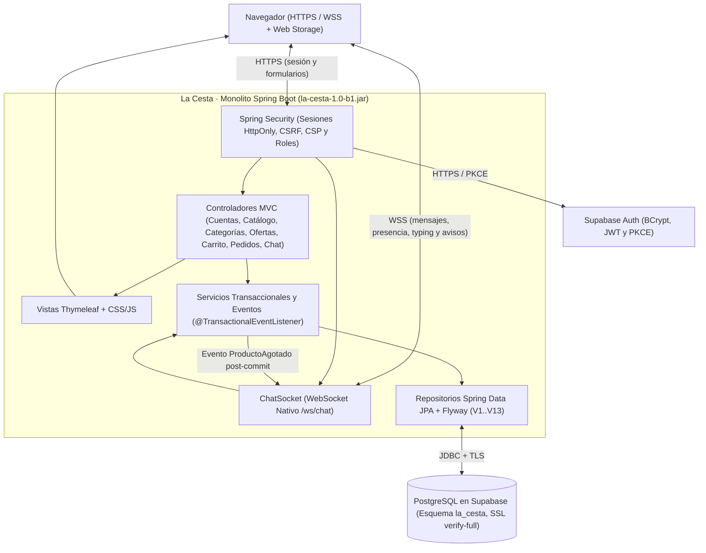
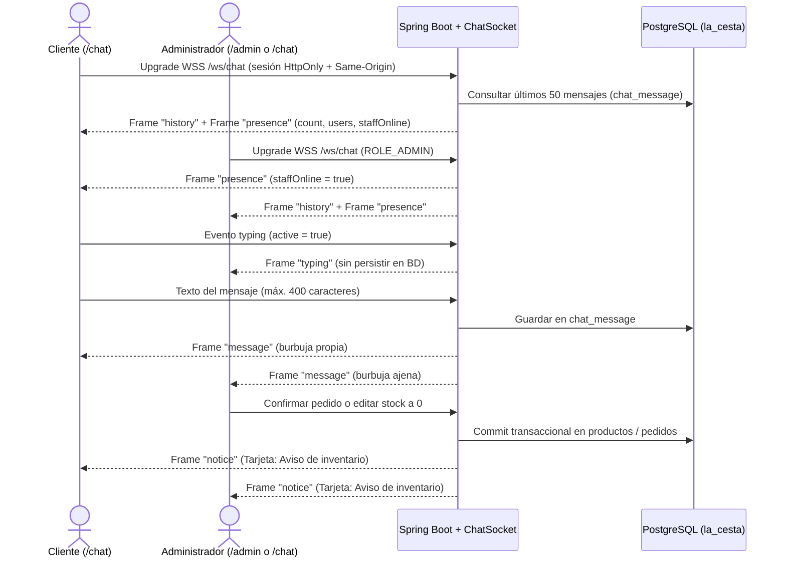
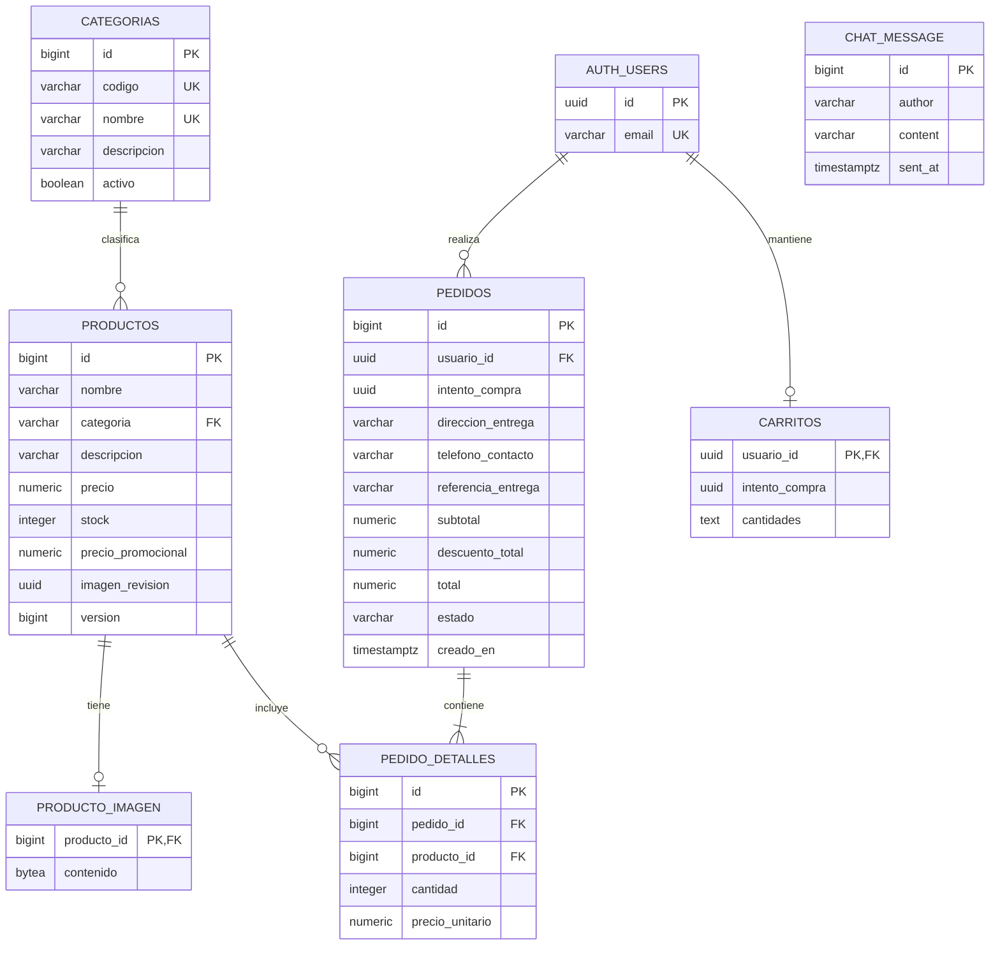

# La Cesta

La Cesta es un minimarket ficticio de Quito. La aplicación web monolítica centraliza el catálogo de productos, las categorías dinámicas, las promociones vigentes, el carrito de compras, la gestión de pedidos y entregas, y una sala general de chat en tiempo real para conectar a clientes y personal de tienda.

Aplicaciones Web Avanzadas · Primer bimestre · Versión `1.0-b1`

El [análisis de requerimientos](docs/REQUERIMIENTOS.md) incluye los objetivos, los criterios de aceptación, el modelo de datos inicial y el guion para la defensa. El [plan de cierre original](docs/Plan%20de%20cierre%20del%20primer%20bimestre.docx) recoge la planificación previa al cambio de autenticación.

## Stack tecnológico

| Capa | Tecnología |
| --- | --- |
| Aplicación monolítica | Java 17 (probado en Java 21/23), Spring Boot 3.5.16, Spring MVC y Maven |
| Interfaz | Thymeleaf, HTML5, CSS3 y JavaScript (`localStorage` / `sessionStorage` para respaldo de carrito) |
| Seguridad | Supabase Auth (BCrypt, JWT y PKCE) para identidades y Spring Security para sesiones HTTP (`HttpOnly`, `SameSite`, CSRF, CSP) y roles (`ROLE_CUSTOMER`, `ROLE_ADMIN`, `ROLE_DELIVERY`) |
| Persistencia | Spring Data JPA, Hibernate y Flyway (`V1` a `V13`) sobre PostgreSQL en Supabase (H2 en memoria para pruebas) |
| Tiempo real | WebSocket nativo seguro (`WSS`) en `/ws/chat` para historial, presencia en vivo, indicador `typing`, insignia `Personal` y avisos post-commit de stock agotado |

## Configurar Supabase

1. En **Connect → Session pooler**, copia el host y el usuario de la conexión PostgreSQL en el puerto `5432`. En **Database Settings → SSL Configuration**, descarga el certificado CA. Usa la contraseña de la base de datos del proyecto. [Conectar a PostgreSQL](https://supabase.com/docs/guides/database/connecting-to-postgres#ssl)
2. En **Project Settings → API Keys**, copia la clave **Publishable** y localiza el **Project URL** en **Connect**. La aplicación usa esa clave para el flujo público de Auth y mantiene las credenciales de PostgreSQL en el servidor. [Claves API de Supabase](https://supabase.com/docs/guides/api/api-keys)
3. En **Authentication → URL Configuration**, añade las dos URL de retorno exactas. Para probar en local son `https://localhost:8080/confirmar` y `https://localhost:8080/restablecer`. Para desplegar, añade las rutas equivalentes bajo el dominio HTTPS de `APP_PUBLIC_URL`. Conserva las plantillas de correo con `{{ .ConfirmationURL }}` para confirmación y recuperación. El usuario debe abrir el enlace en el mismo navegador en que lo solicitó. [Flujo PKCE](https://supabase.com/docs/guides/auth/sessions/pkce-flow)
4. En **Authentication → Sign In / Providers**, habilita correo y contraseña y mantén activa la confirmación de correo. Configura SMTP propio para enviar correos a clientes ajenos al equipo. [Contraseñas en Supabase Auth](https://supabase.com/docs/guides/auth/passwords) · [SMTP personalizado](https://supabase.com/docs/guides/auth/auth-smtp)

## Ejecutar en local

1. Abre la carpeta como proyecto Maven y selecciona un JDK 17 a 25. Detén la ejecución anterior antes de cambiar de configuración.
2. En IntelliJ IDEA (**Run → Edit Configurations**), duplica **La Cesta Supabase** como configuración local y carga las variables reales en **Environment variables** usando [.env.example](.env.example) como plantilla (o expórtalas en PowerShell si ejecutas desde terminal).
3. Prepara el certificado TLS local ejecutando estos comandos desde la raíz del proyecto:

```powershell
powershell.exe -NoProfile -ExecutionPolicy Bypass -File .\scripts\prepare-local-tls.ps1
Import-Certificate -FilePath .\data\tls\localhost.cer -CertStoreLocation Cert:\CurrentUser\Root
```

4. Arranca la aplicación y entra a `https://localhost:8080/ingresar`. Flyway crea o actualiza el esquema `la_cesta`.
5. Registra y confirma la cuenta administradora; en **Authentication → Users**, copia su **User UID** en `APP_ADMIN_USER_ID` y reinicia para habilitar `/admin` (gestión de productos, categorías, ofertas y pedidos). Para probar flujo de cliente y repartidor (`ROLE_DELIVERY`) en paralelo, abre otra cuenta en una ventana privada.

Para introducir la contraseña de PostgreSQL al arrancar desde PowerShell sin guardarla en el IDE:

```powershell
$env:DB_PASSWORD = Read-Host 'Contraseña de PostgreSQL' -MaskInput
try {
    mvn spring-boot:run
} finally {
    Remove-Item Env:DB_PASSWORD
}
```

Para desplegar con TLS directo, usa un certificado válido para tu dominio y configura `APP_TLS_KEY_STORE`, `APP_TLS_KEY_STORE_PASSWORD` y `APP_PUBLIC_URL`. Si un proxy confiable termina HTTPS, configura `APP_TLS_ENABLED=false` y `APP_FORWARD_HEADERS_STRATEGY=framework`, mantén el backend privado y haz que el proxy reemplace los encabezados reenviados y admita la actualización WebSocket.

## Módulos principales

* **Cuentas y seguridad (`/ingresar`, `/registro`, `/recuperar`, `/restablecer`):** registro con confirmación de correo, validación JWT con Supabase Auth, sesiones HTTP seguras y recuperación PKCE con caducidad de 20 minutos.
* **Catálogo, categorías y ofertas (`/productos`, `/ofertas`, `/admin/categorias`, `/admin/ofertas`):** listado paginado de 8 productos por página, filtrado por categorías dinámicas activas/inactivas, sección de ofertas con cálculo de ahorro, control de concurrencia optimista (`@Version`) y carga/conversión de imágenes JPG/PNG a JPEG optimizado.
* **Carrito, pedidos y entregas (`/carrito`, `/pedidos`, `/admin/pedidos`, `/entregas`):** carrito persistido en `la_cesta.carritos` con respaldo en navegador, validación transaccional de stock al confirmar pedidos en `pedidos` y `pedido_detalles`, y panel logístico (`En espera` / `Entregado`) para `ROLE_DELIVERY`.
* **Sala general en tiempo real (`/chat`, `wss://localhost:8080/ws/chat`):** historial de últimos 50 mensajes, diferenciación visual propia/ajena, avatares con iniciales, insignia `Personal` para administradores, lista de usuarios conectados (`En la sala`) con estado de disponibilidad del personal, indicador `typing`, buscador instantáneo, consultas rápidas, envío con `Enter` y tarjetas de aviso cuando un producto se agota.

## Consultar los datos en Supabase

Abre **Table Editor**, selecciona el esquema `la_cesta` y revisa las tablas `categorias`, `productos`, `producto_imagen`, `carritos`, `pedidos`, `pedido_detalles` y `chat_message`. Consulta las identidades en **Authentication → Users**. [Base de datos en el panel de Supabase](https://supabase.com/docs/guides/database/overview)

```sql
select p.id, p.nombre, c.nombre as categoria, p.precio, p.precio_promocional, p.stock
from la_cesta.productos p
join la_cesta.categorias c on c.codigo = p.categoria
order by p.id desc
limit 20;
```

## Variables de entorno

[.env.example](.env.example) es la plantilla pública. Introduce los valores reales en las variables de entorno del proceso o IDE, nunca dentro del repositorio.

| Variable | Uso |
| --- | --- |
| `DB_HOST` | Host del Session pooler, sin protocolo ni puerto. La aplicación fija el puerto `5432` y `sslmode=verify-full`. |
| `DB_USER` | Usuario de PostgreSQL, con permisos sobre el esquema `la_cesta`. |
| `DB_PASSWORD` | Contraseña de PostgreSQL. |
| `DB_SSL_ROOT_CERT` | Ruta al certificado CA descargado de Supabase. |
| `SUPABASE_URL` | Origen HTTPS del proyecto, por ejemplo `https://PROJECT_REF.supabase.co`. |
| `SUPABASE_PUBLISHABLE_KEY` | Clave `sb_publishable_…` para llamar a Supabase Auth. |
| `APP_ADMIN_USER_ID` | UUID del usuario de Supabase Auth autorizado como `ROLE_ADMIN`. |
| `APP_PUBLIC_URL` | Origen de La Cesta para enlaces de correo. El valor local es `https://localhost:8080`. |
| `APP_TLS_ENABLED` | `true` por defecto. Usa `false` si un proxy de confianza termina TLS. |
| `APP_TLS_KEY_STORE` | Ubicación del almacén PKCS#12 cuando Spring gestiona HTTPS (`data/tls/localhost.p12`). |
| `APP_TLS_KEY_STORE_PASSWORD` | Contraseña del almacén PKCS#12 (generada en `data/tls/local.properties`). |
| `APP_FORWARD_HEADERS_STRATEGY` | `none` por defecto. Usa `framework` si un proxy confiable termina HTTPS. |

## Credenciales y datos de prueba

Publica solo `.env.example` con valores de muestra. Guarda las contraseñas, los tokens y las claves privadas fuera del repositorio y verifica con `git diff --cached --name-only -- .` antes de cada commit.

Supabase Auth almacena contraseñas con BCrypt. Spring valida credenciales e intercambia el JWT de acceso por HTTPS en el servidor, mantiene una cookie de sesión `HttpOnly` y `SameSite=Lax`, y descarta el token tras autenticar. JPA parametriza todas las consultas, JDBC exige TLS con verificación de certificado y host, y las migraciones `V7`, `V9` y `V13` revocan permisos a `anon`/`authenticated` y habilitan RLS sobre las tablas de `la_cesta`.

## Arquitectura y flujo de operación



### Flujo en tiempo real y eventos de stock



1. **Autenticación y roles:** Spring Security autentica mediante Supabase Auth y asigna `ROLE_ADMIN`, `ROLE_DELIVERY` o `ROLE_CUSTOMER`.
2. **Catálogo y categorías:** El administrador gestiona categorías activas y productos paginados (8 ítems/página) con fotos JPEG optimizadas y control de versión `@Version`.
3. **Carrito y pedidos:** `CarritoService` sincroniza cantidades con el servidor, verifica stock con bloqueo pesimista al confirmar y crea `pedidos` y `pedido_detalles` en una transacción.
4. **Sala general por WSS:** `ChatSocket` valida la sesión y el origen durante el handshake, difunde presencia (`users`, `staffOnline`), eventos `typing` en vivo, mensajes persistidos con insignia `Personal` y notificaciones post-commit de `ProductoAgotado`.

## Modelo de datos (Esquema `la_cesta`)

Flyway administra las migraciones desde [db/migration](src/main/resources/db/migration) y las reglas de PostgreSQL/H2 desde [db/postgresql](src/main/resources/db/postgresql) y [db/h2](src/test/resources/db/h2).



### Índices y migraciones clave

| Tabla | Índice / Restricción | Migración | Propósito |
| --- | --- | --- | --- |
| `productos` | `productos_categoria_id_idx (categoria, id desc)` | `V2`, `V10` | Filtrado por categoría y paginación descendente (8 ítems/página) |
| `categorias` | `codigo` (`UNIQUE`), `nombre` (`UNIQUE`) | `V9`, `V10` | Integridad referencial con `productos.categoria` (`ON UPDATE/DELETE RESTRICT`) |
| `pedidos` | `pedidos_usuario_id_idx (usuario_id, creado_en desc)` | `V11` | Consulta rápida del historial de pedidos por cliente |
| `pedidos` | `pedidos_intento_compra_idx (usuario_id, intento_compra)` (`UNIQUE`) | `V12` | Idempotencia al confirmar compras |
| `pedido_detalles` | `pedido_detalles_pedido_id_idx (pedido_id)` | `V11` | Carga de líneas de detalle de cada pedido |
| `chat_message` | Clave primaria `id` | `V3` | Lectura acotada de los últimos 50 mensajes en orden descendente |

> Nota: `la_cesta.app_user` (`V1`) se conserva como tabla histórica protegida por RLS; las identidades activas residen en `auth.users` de Supabase.

## Pruebas y rendimiento

```powershell
mvn test
mvn package
```

La suite automatizada ejecuta **26 pruebas** usando H2 en memoria (con Flyway completo) y mocks para Supabase Auth:

| Clase de prueba | Cantidad | Cobertura |
| --- | --- | --- |
| `SupabaseAuthClientTest` | 4 | Registro, inicio de sesión, intercambio PKCE y manejo de errores con Supabase Auth |
| `CarritoTest` | 3 | Sincronización de carrito, cálculo de ofertas/totales, bloqueo de stock y confirmación de pedidos |
| `CatalogoTest` | 6 | Validaciones de precio/stock, ofertas, paginación de 8 ítems, control `@Version` y carga de fotos |
| `ChatTest` | 5 | Normalización/límites de texto, historial de 50 mensajes, vista `/chat`, presencia + `typing` + aviso de stock por WebSocket y medición de rendimiento |
| `MonolitoTest` | 8 | Rutas protegidas, separación de portadas por rol, flujo PKCE, eliminación confirmada y handshake/mensajería WSS |

El artefacto ejecutable se genera en `target/la-cesta-1.0-b1.jar`.

### Medición de rendimiento (consulta paginada, índice e historial de chat)

La prueba `ChatTest#mideTiempoDeRespuestaYVerificaIndiceEnConsultaPaginadaYChat` automatiza la verificación en cada `mvn test` insertando **10 000 productos ficticios**, ejecutando `EXPLAIN ANALYZE` para confirmar el uso de índice (sin `tableScan`), realizando 20 iteraciones de calentamiento y 100 mediciones de lectura de la primera página de 8 productos de `BEBIDAS`, además de medir el tiempo de carga del historial de 50 mensajes del chat:

```sql
SELECT id, nombre
FROM la_cesta.productos
WHERE categoria = 'BEBIDAS'
ORDER BY id DESC
LIMIT 8;
```

* **Medición automatizada actual (H2 2.3.232, Java 21):** mediana **0,015 ms** y percentil 95 **0,032 ms** para la consulta paginada; **4,526 ms** para la carga del historial de 50 mensajes en `ChatService`.
* **Medición local previa de referencia (Java 23):** mediana **0,034 ms** y percentil 95 **0,071 ms** con uso del índice `productos_categoria_id_idx`.

## Integrantes

| Integrante | Rol | Responsabilidad |
| --- | --- | --- |
| **Saúl Tualombo** | Arquitectura, seguridad y ofertas | Base del monolito Spring Boot, Supabase Auth/JWT, TLS local, portada editorial y módulo de ofertas (`/ofertas`, `/admin/ofertas`) |
| **Priscila Pazmiño** | Categorías y refactorización de esquema | Gestión dinámica de categorías (`/admin/categorias`), migraciones `V9`/`V10` y filtros de catálogo |
| **Julián Narváez** | Carrito, pedidos y logística Delivery | Carrito híbrido (`carritos`), confirmación transaccional (`pedidos`, `pedido_detalles`) y gestión de entregas (`ROLE_DELIVERY`) |
| **Jonathan** | Pasarela de pagos | Integración del botón/flujo de pago y registro de transacciones |
| **Jimmy Arias** | Tiempo real, UX de chat y pruebas | Mejoras en `/chat` (burbujas, avatares, insignia `Personal`, presencia en vivo, indicador `typing`, filtro, consultas rápidas, tarjetas de aviso de stock), suite `ChatTest` y medición automatizada de rendimiento |

## Uso de IA

Se utilizó **Codex**, **Gemini** y **Antigravity** como apoyo para estructurar requerimientos, redactar documentación, generar bocetos/diapositivas, plantear pruebas automatizadas y depurar componentes. Se aplicó [Ponytail](https://github.com/dietrichgebert/ponytail) para reducir la complejidad del código, y se consultaron [Taste Skill](https://www.tasteskill.dev/) e [Impeccable](https://github.com/pbakaus/impeccable) para la jerarquía visual, los estados de interfaz y la revisión responsiva. Las ilustraciones editoriales y fotografías de productos ficticios se generaron con **ImageGen**. Los cambios de diapositiva y microinteracciones adaptan patrones de [Frontend Animations](https://github.com/pulkit-30/Frontend-Animations). Los títulos usan [Barlow Condensed](https://github.com/google/fonts/tree/main/ofl/barlowcondensed) (licencia SIL OFL). Todo el código y documentación fue revisado, probado e integrado por el equipo.
